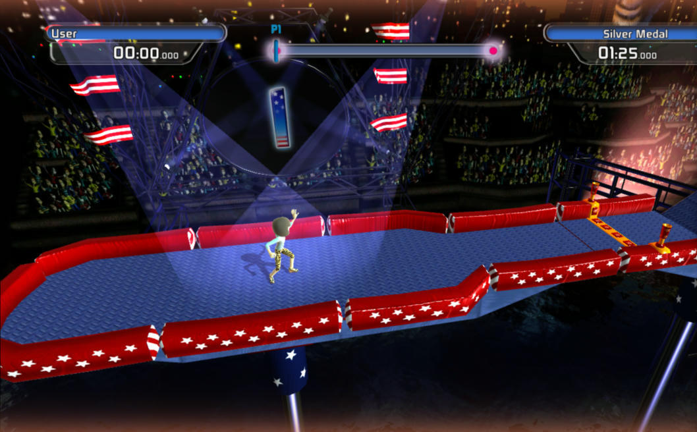

# Doritos Crash Course 2: native PC port WIP

A static recompilation of the Xbox Live Arcade game *Doritos Crash Course 2*
(title ID `58410A71`) to a native Windows executable, built with
[ReXGlue](https://github.com/rexglue/rexglue-sdk). **It's playable on Windows**:
full levels with an Xbox controller or keyboard, pause, saves, and **your own
Xbox avatar** as the character. See [STATUS.md](STATUS.md).



**No game files are included.** You need your own copy of *Doritos Crash
Course 2* (Xbox Live Arcade). The game's code and data are copyrighted and are
not distributed here.

## Getting the game files

Put these two files from your copy of the game into the `game/` folder:

- `default.xex`
- `data.pak`

If you have the XBLA package file (the 42-character file from your Xbox 360's
`Content/<profile>/58410A71/000D0000/` folder), the included extractor unpacks
it:

```
python tools/stfs_extract.py <package file> extracted/
```

then copy `default.xex` and `data.pak` from `extracted/` into `game/`.

## Building

Windows, without Visual Studio: install LLVM, CMake and Ninja
(`choco install llvm cmake ninja`), download
the ReXGlue SDK release named in the workflow (`REXGLUE_VERSION`), then:

```
cmake --preset win-amd64-release -DCMAKE_PREFIX_PATH=<sdk>/win-amd64
cmake --build out/build/win-amd64-release --target doritos_crash_course_codegen
cmake --preset win-amd64-release
cmake --build out/build/win-amd64-release
```

The Windows SDK headers come from the Visual Studio Build Tools (GitHub's
runners already have them).

The GitHub Actions workflow does the same. It only builds when the game files
are available to it, so on this repository it skips the build; on a private
copy of this repository with your own game files committed
(`git add -f game/default.xex game/data.pak`), it produces
a ready-to-run zip.

## Playing

Run the exe with the `game` folder (holding `default.xex` and `data.pak`)
next to it. Windows needs 64-bit Windows 10/11 and a DirectX 12 capable GPU.
The Linux build (`./DoritosCrashCourse`) needs glibc 2.38+ (Ubuntu 24.04 or
newer) and a Vulkan driver; the avatar app is Windows-only, so Linux uses the
stand-in character.
An Xbox controller works, and so does the keyboard (Space = A, Enter = Start,
WASD = stick; the full list is in `packaging/README.txt`). Logs go to `logs/`
next to the exe. Press **F1** (or **LB + RB + X**) for the settings menu
(avatar, resolution, fullscreen, frame limiter, vsync, texture filtering, sound
and controls), **F3** for the frame-rate overlay; **Start** (or Enter) pauses.

On the "not signed in to Xbox LIVE" message, press **B** (or Backspace) to
carry on; online features aren't available.

## Your Xbox avatar

The characters are Xbox avatars. **The app below is optional**: without it the
game uses a stand-in character, which it makes from the game's own `data.pak`
the first time it starts. To play as your own
avatar:

1. Install the free [**Xbox Original Avatars**](https://apps.microsoft.com/detail/9nblgggz5qdq) app from the
   Microsoft Store.
2. Open it once, signed in with your Xbox account, and let your avatar load.
   That downloads your avatar's parts to the app's cache, which the game reads.
3. Start the game. If it picks the wrong avatar, set your gamertag in
   `doritos_crash_course.toml` next to the exe:
   `avatar_gamertag = "YourTag"`

The other racers use your friends' avatars from the app (or random outfits).
All avatar settings are listed
in `doritos_crash_course.toml`.

## How the build works

```
game/default.xex  ──rexglue codegen──▶  generated/default/*.cpp  ──clang──▶  DoritosCrashCourse.exe
                                                                    + ReXGlue runtime
                                                                      (kernel, GPU, audio, input)
```

- `doritos_crash_course_manifest.toml`: ReXGlue project manifest.
- `doritos_crash_course_config.toml`, `doritos_crash_course_functions.toml`:
  codegen fixes on top of ReXGlue's analysis (see STATUS.md).
- `src/`: the app. `doritos_crash_course_app.h` makes the exe find the `game`
  folder next to itself and selects the GPU plugin, so no command-line flags
  are needed; `usbcam_stubs.cpp` stubs the camera imports;
  `avatar_standin.cpp` and `avatar_real.cpp` serve the Xbox avatar (with
  gibbed's xenia avatar loader in `src/avatars/`, BSD licence);
  `standin_maker.cpp` builds the stand-in character from `data.pak`
  (third-party decoders in `src/third_party/`);
  `frame_stats.cpp` feeds the F3 FPS overlay; `input_fix.cpp` fixes
  controller reads (pause and B); `dcc_menu.cpp` is the F1 settings menu;
  `crash_handler.cpp` writes `crash.txt`; `game_exit.cpp` handles quitting
  and Linux memory cleanup. The menu, frame limiter, crash handler and exit
  handling come from the Trials HD port.
- `packaging/`: README and settings file for the packaged build.
- `generated/rexglue.cmake`: ReXGlue CMake glue (from `rexglue init`).
- `generated/default/`: recompiled C++, produced during every build and not
  committed (about 150 MB).
- `.github/workflows/build-windows.yml`: the Windows CI build.
- `tools/`: `find_callback_functions.py` regenerates the functions list;
  `stfs_extract.py` unpacks the original XBLA package; the rest is from the
  earlier XenonRecomp analysis.

## Status

See [STATUS.md](STATUS.md).
