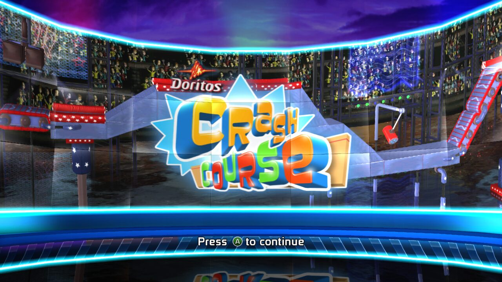
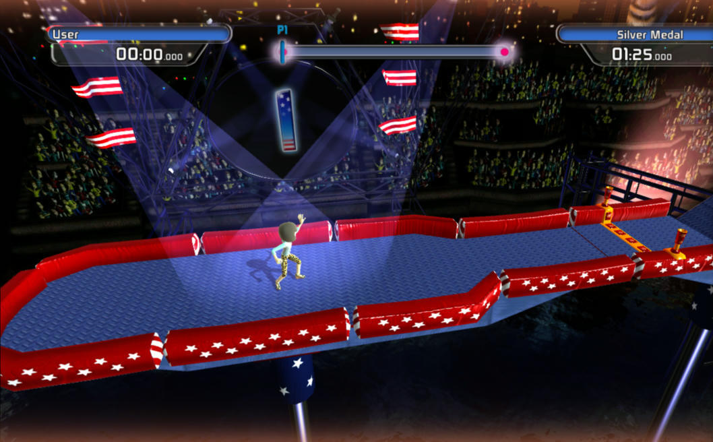

# Status

Game: **Doritos Crash Course 2** (XBLA, title ID `58410A71`, XEX version 2,
built 2010-12-01). Recompiled with ReXGlue SDK v0.10.0.

## What works

Played on a Windows PC with an Xbox controller: levels through the USA set
completed with the player's own avatar, pause and menus working, F3 shows the
frame rate. Earlier testing on Linux used a software Vulkan renderer (Mesa
llvmpipe) on a virtual display:

| Stage | Result |
| --- | --- |
| Codegen (whole executable) | Clean: no unhandled instructions, no unresolved branches |
| Build and link | Clean on Linux (clang 20) and Windows CI (LLVM via Chocolatey) |
| Boot, Xbox Live Arcade / Behaviour splash screens | Works |
| Title screen ("Press A to continue") | Works |
| Profile save ("Saving...") | Works |
| Main menu, Single Player, country select, level select | Works |
| Starting a level / gameplay | Works (Windows, Direct3D 12) |

## Not yet verified

- **Audio** in detail (the Linux test machine had no audio device).
- Levels beyond the first few, multiplayer, and leaderboards (Xbox LIVE isn't
  available, so the game reports a profile without LIVE).

## Avatars

The player and the other characters are Xbox avatars. With the free **Xbox
Original Avatars** app (Microsoft Store) installed and opened once while signed
in, the game uses your own avatar: the app caches the same avatar parts as the
360's system avatar library, and `src/avatar_real.cpp` builds them with gibbed's
xenia avatar loader (`src/avatars`). Other characters use your friends'
avatars from the app's friends list, or random outfits from the same cache.
Set `avatar_gamertag` if it picks the wrong avatar. Without the app, a
stand-in made from the game's own placeholder
character is used. Settings: see `doritos_crash_course.toml`.

## Fixes applied on top of ReXGlue's automatic analysis

All live in `doritos_crash_course_config.toml` and
`doritos_crash_course_functions.toml`, included from the manifest:

1. **Jump table at `0x8285DCF4`** (in `sub_8285DCB0`): dispatches without a
   bounds check, so auto-detection read 512 entries instead of 16 and merged
   the next function in. Pinned to the real 16 entries.
2. **Functions reached only through pointers**: 416 virtual-call thunks and 4
   small callbacks that ReXGlue's discovery doesn't find. Calling one aborted
   with "Call to invalid or unregistered function". Regenerate the list with
   `tools/find_callback_functions.py` (see its header) if the config changes.
3. **Xbox Live Vision camera imports** (`src/usbcam_stubs.cpp`): not in
   ReXGlue's kernel; they report no camera.
4. **Launch defaults** (`src/doritos_crash_course_app.h`): the exe finds the
   `game` folder next to itself and selects the Xenos GPU plugin, so it needs
   no command-line flags.
5. **Controller state** (`src/input_fix.cpp`): the game reads each pad twice
   per frame and ORs the second result into the first. The second call is
   rejected by the runtime without writing its buffer, so stale stack bytes
   looked like buttons held down and Start (pause) and B (back) stopped
   registering. Failed reads now return a cleared state.
6. **F3 frame rate** (`src/frame_stats.cpp`): counts the game's VdSwap calls
   and feeds the debug overlay's FPS line.
7. **Full game, not the trial** (`src/doritos_crash_course_app.h`): ReXGlue
   reports a licence mask of 0 (XBLA trial) by default; it's now set to all
   bits granted, as in the Trials HD port.
8. **From the Trials HD port:** the F1 settings menu (`src/dcc_menu.cpp`),
   the 60 fps frame limiter and Windows 1 ms timer resolution
   (`src/frame_stats.cpp`), `crash.txt` on crashes (`src/crash_handler.cpp`),
   clean quitting and Linux `/dev/shm` memory cleanup (`src/game_exit.cpp`).

## If it crashes

Check `logs/` next to the exe. The common failure for a new code path is:

- `Call to invalid or unregistered function at guest address 0x...`: a
  function ReXGlue didn't discover. Add it under `[functions]` in
  `doritos_crash_course_config.toml`.
- `Unresolved branch from 0x... to 0x...`: a function boundary is wrong. Add a
  `[functions]` entry with the correct `end`, or fix a jump table under
  `[[switch_tables]]`.
